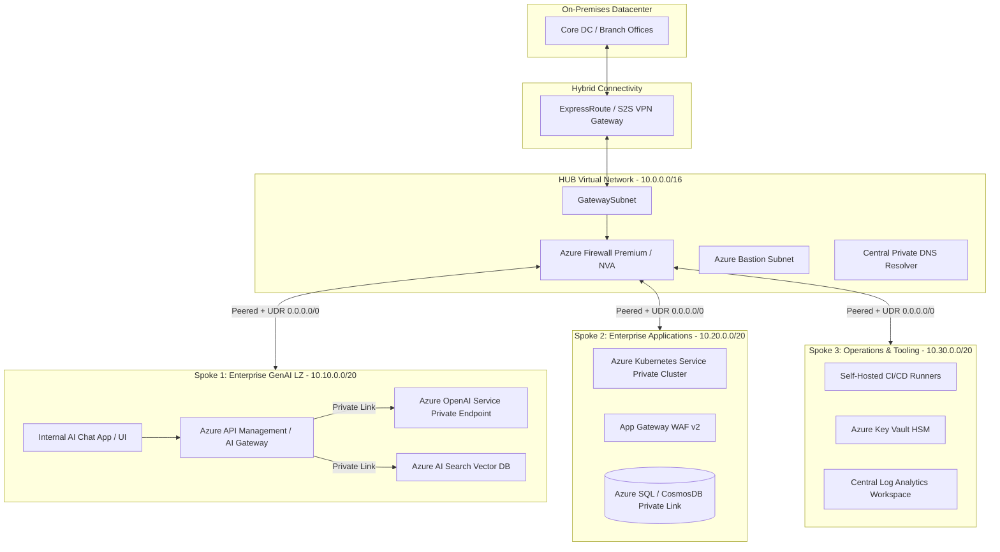
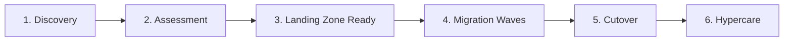

# 🏛️ Enterprise Azure Landing Zone (CAF), Hub-and-Spoke & GenAI Architecture
### *Production-Grade Terraform Modular Framework | DevSecOps | FinOps | Enterprise Migration Strategy*

<p align="center">
  
  
  
  
  
  
  
</p>

---

## 🌟 Executive Summary & Portfolio Overview

This repository represents an **Enterprise-Scale Reference Architecture** designed for Senior Cloud / DevOps Architects. It demonstrates end-to-end cloud adoption following the **Microsoft Cloud Adoption Framework (CAF)**, featuring:
- **Enterprise Azure Landing Zone** with hierarchical Governance & Policy Guardrails.
- **Enterprise AI / GenAI Landing Zone** integrating **Azure OpenAI**, **Azure AI Search (RAG)**, and **APIM GenAI Gateway** with zero-trust private networking.
- **Centralized Hub-and-Spoke Virtual Network Topology** with Azure Firewall Premium inspection, Hybrid ExpressRoute/VPN connectivity, and Private Endpoints.
- **Production-Ready, Parameterized Terraform Modules** governed by automated DevSecOps pipelines (`tflint`, `tfsec`, `checkov`, `infracost`).
- **100+ Enterprise Workload Migration Playbook** including RTO/RPO targets, FinOps cost governance, and Vendor/RACI delivery models.

---

## 📑 Table of Contents
1. [Enterprise Architecture Blueprint](#-enterprise-architecture-blueprint)
2. [Azure AI / GenAI Landing Zone Architecture](#-azure-ai--genai-landing-zone-architecture)
3. [Hub-and-Spoke Network Architecture](#-hub-and-spoke-network-architecture)
4. [Enterprise Governance & Management Hierarchy](#-enterprise-governance--management-hierarchy)
5. [Modular Terraform Landing Zone Framework](#-modular-terraform-landing-zone-framework)
6. [Multi-Layered Defense-in-Depth Security](#-multi-layered-defense-in-depth-security)
7. [DevSecOps & CI/CD Pipeline Automation](#-devsecops--cicd-pipeline-automation)
8. [100+ Workload Cloud Migration Framework](#-100-workload-cloud-migration-framework)
9. [FinOps (Cloud Financial Management) Playbook](#-finops-cloud-financial-management-playbook)
10. [Disaster Recovery, High Availability & SRE (RTO/RPO)](#-disaster-recovery-high-availability--sre-rtorpo)
11. [Vendor Management & Delivery Governance](#-vendor-management--delivery-governance)

---

## 🏗️ Enterprise Architecture Blueprint



---

## 🤖 Azure AI / GenAI Landing Zone Architecture

Integrating Generative AI at enterprise scale requires strict data isolation, zero-trust perimeter enforcement, token governance, and high availability.

### 1. Enterprise GenAI Architectural Principles
- **No Public Endpoints:** Azure OpenAI and Azure AI Search instances are provisioned with `public_network_access_enabled = false` and accessed exclusively via **Private Endpoints (`privatelink.openai.azure.com`)**.
- **Customer Data Privacy:** Zero data retention policies with Microsoft; prompt data is never used to train public models.
- **Enterprise RAG (Retrieval-Augmented Generation):** Integrated with Azure AI Search utilizing hybrid search (Dense Vector Embeddings + Full-Text BM25) and Semantic Reranking.
- **Content Safety:** Integrated Azure AI Content Safety filters for hate speech, self-harm, sexual content, and prompt injection/jailbreak detection.

### 2. GenAI Gateway Pattern via Azure API Management (APIM)
```
[ User / App Request ]
         |
         v
[ Azure Application Gateway (WAF v2 + TLS Termination) ]
         |
         v
[ Azure API Management (GenAI Gateway) ]
    ├── Token Bucket Rate Limiting (Prevent Quota Exhaustion)
    ├── Smart Load Balancing across Multi-Region OpenAI Endpoints
    ├── Semantic Caching via Azure Cache for Redis (Cut Costs & Latency by 40%)
    ├── Detailed Token Usage & Chargeback Metrics (FinOps Attribution)
    └── Content Safety Pre/Post Processing
         |
         v
[ Private Endpoint: Azure OpenAI (GPT-4o / Embedding Models) ]
```

---

## 🌐 Hub-and-Spoke Network Architecture

```
                       [ On-Premises Datacenter ]
                                   |
                     (ExpressRoute / S2S VPN Gateway)
                                   |
+----------------------------------v----------------------------------+
|                   HUB VNet (Central Connectivity)                   |
|                                                                     |
|  +--------------------+   +-------------------+   +--------------+  |
|  | Azure Firewall /   |   | GatewaySubnet     |   | Private DNS  |  |
|  | NVA (Inspection)   |   | (VPN/ER Gateway)  |   | Zones        |  |
|  +---------+----------+   +-------------------+   +--------------+  |
+------------|--------------------------------------------------------+
             | (VNet Peering + UDR: 0.0.0.0/0 -> Firewall Private IP)
             +-----------------------+-----------------------+
             |                       |                       |
+------------v------------+ +--------v---------------+ +-----v--------------------+
|  Spoke 1: App VNet      | | Spoke 2: Shared VNet   | | Spoke 3: GenAI Landing Zone|
|  - App Tier Subnets     | | - CI/CD Runners        | | - Azure OpenAI Instances   |
|  - DB Tier Subnets      | | - Bastion Host         | | - Azure AI Search Clusters |
|  - Private Endpoints    | | - Security / Tooling   | | - GenAI APIM Gateway       |
+-------------------------+ +------------------------+ +----------------------------+
```

### Key Networking Elements & Rules
| Pillar | Design Decision | Rationale |
| :--- | :--- | :--- |
| **IPAM & CIDRs** | Centralized Non-Overlapping Subnets | Avoid IP collisions across On-Premises datacenters and multi-region Azure deployments. |
| **Forced Tunneling** | UDR `0.0.0.0/0` targeting Azure Firewall Private IP | Complete inspection of all egress and inter-spoke traffic; no direct public internet breakouts. |
| **Private DNS Resolution**| Hub Azure Private DNS Resolver with central forwarders | Resolves `privatelink.*` domains natively across On-Prem, Hub, and Spokes. |
| **Inbound Traffic** | Azure Application Gateway (WAF) or Azure Front Door | Enterprise L7 inspection, SSL offloading, and OWASP Top 10 rule enforcement. |

---

## 🏛️ Enterprise Governance & Management Hierarchy

Following Microsoft CAF, organizational boundaries are divided into dedicated Management Groups to enforce RBAC and Azure Policy guardrails at scale:

```
                            [ Microsoft Entra ID Tenant ]
                                          |
                              [ Tenant Root Group ]
                                          |
         +--------------------------------+--------------------------------+
         |                                |                                |
[ Platform Management Group ]   [ Landing Zones (Workloads) ]    [ Decommissioned / Sandbox ]
   |-- Identity (AD/DNS)           |-- Corp (Internal Only)         |-- Sandbox MG
   |-- Management (Logs/Mon)       |-- Online (Public/DMZ)          |-- Decommissioned MG
   `-- Connectivity (Hub/Firewall) |-- GenAI / Data Science MG
                                   |-- Dev Subscriptions
                                   |-- UAT Subscriptions
                                   `-- Prod Subscriptions
```

### Guardrails via Azure Policy & Initiatives
- **CIS Azure Foundations & Microsoft Cloud Security Benchmark (MCSB):** Assigned at Tenant Root level.
- **Allowed Regions Policy:** Enforce deployment strictly to approved sovereign regions (e.g., `East US`, `West Europe`, `Central India`).
- **Deny Public IP Creation:** Automatically block creation of unmanaged Public IPs inside workload/spoke subnets.
- **Mandatory Tagging:** Require `CostCenter`, `Environment`, `Owner`, and `ApplicationID` before resource creation.

---

## 📦 Modular Terraform Landing Zone Framework

Production-grade IaC must be **DRY**, **strictly typed**, **versioned**, and **modular**.

### Directory Structure
```text
terraform-azure-landing-zone/
├── environments/
│   ├── dev/
│   │   ├── main.tf
│   │   ├── variables.tf
│   │   └── terraform.tfvars
│   ├── uat/
│   └── prod/
├── modules/
│   ├── networking/
│   │   ├── hub/
│   │   │   ├── main.tf
│   │   │   ├── firewall.tf
│   │   │   ├── outputs.tf
│   │   │   └── variables.tf
│   │   └── spoke/
│   │       ├── main.tf
│   │       ├── peering.tf
│   │       └── routes.tf
│   ├── ai_landing_zone/
│   │   ├── main.tf
│   │   ├── openai.tf
│   │   ├── private_endpoints.tf
│   │   ├── apim_gateway.tf
│   │   └── variables.tf
│   ├── security_governance/
│   │   ├── policies.tf
│   │   └── rbac.tf
│   └── monitoring/
│       ├── log_analytics.tf
│       └── alerts.tf
├── .tflint.hcl
├── .checkov.yml
└── README.md
```

### Module Code Samples

<details>
<summary><b>▶ Click to view: Azure OpenAI Private Landing Zone Terraform Module</b></summary>

```hcl
# modules/ai_landing_zone/openai.tf
resource "azurerm_cognitive_account" "openai" {
  name                          = var.openai_account_name
  location                      = var.location
  resource_group_name           = var.resource_group_name
  kind                          = "OpenAI"
  sku_name                      = "S0"
  public_network_access_enabled = false
  custom_subdomain_name         = var.custom_subdomain_name

  network_acls {
    default_action = "Deny"
    ip_rules       = []
  }

  identity {
    type = "SystemAssigned"
  }

  tags = var.tags
}

resource "azurerm_cognitive_deployment" "gpt4o" {
  name                 = "gpt-4o"
  cognitive_account_id = azurerm_cognitive_account.openai.id

  model {
    format  = "OpenAI"
    name    = "gpt-4o"
    version = "2024-05-13"
  }

  scale {
    type     = "Standard"
    capacity = var.model_capacity_tpm
  }
}

resource "azurerm_private_endpoint" "openai_pe" {
  name                = "${var.openai_account_name}-pe"
  location            = var.location
  resource_group_name = var.resource_group_name
  subnet_id           = var.private_endpoint_subnet_id

  private_service_connection {
    name                           = "${var.openai_account_name}-psc"
    private_connection_resource_id = azurerm_cognitive_account.openai.id
    subresource_names              = ["account"]
    is_manual_connection           = false
  }

  private_dns_zone_group {
    name                 = "openai-dns-zone-group"
    private_dns_zone_ids = [var.private_dns_zone_openai_id]
  }

  tags = var.tags
}
```
</details>

<details>
<summary><b>▶ Click to view: Hub VNet & Azure Firewall Module</b></summary>

```hcl
# modules/networking/hub/main.tf
resource "azurerm_virtual_network" "hub" {
  name                = var.hub_vnet_name
  location            = var.location
  resource_group_name = var.resource_group_name
  address_space       = [var.hub_address_space]
  tags                = var.tags
}

resource "azurerm_subnet" "firewall" {
  name                 = "AzureFirewallSubnet"
  resource_group_name  = var.resource_group_name
  virtual_network_name = azurerm_virtual_network.hub.name
  address_prefixes     = [var.firewall_subnet_prefix]
}

resource "azurerm_public_ip" "fw_pip" {
  name                = "${var.hub_vnet_name}-fw-pip"
  location            = var.location
  resource_group_name = var.resource_group_name
  allocation_method   = "Static"
  sku                 = "Standard"
  tags                = var.tags
}

resource "azurerm_firewall" "hub_fw" {
  name                = "${var.hub_vnet_name}-firewall"
  location            = var.location
  resource_group_name = var.resource_group_name
  sku_name            = "AZFW_VNet"
  sku_tier            = "Premium"

  ip_configuration {
    name                 = "configuration"
    subnet_id            = azurerm_subnet.firewall.id
    public_ip_address_id = azurerm_public_ip.fw_pip.id
  }
  tags = var.tags
}
```
</details>

<details>
<summary><b>▶ Click to view: Remote State Backend with Blob Leasing & CMK</b></summary>

```hcl
# backend.tf
terraform {
  required_version = ">= 1.8.0"
  required_providers {
    azurerm = {
      source  = "hashicorp/azurerm"
      version = "~> 3.100.0"
    }
  }
  backend "azurerm" {
    resource_group_name  = "rg-terraform-mgmt-prod"
    storage_account_name = "sttfstateenterpriseprod"
    container_name       = "tfstate"
    key                  = "landingzone.enterprise.terraform.tfstate"
    use_azuread_auth     = true
  }
}
```
</details>

---

## 🔒 Multi-Layered Defense-in-Depth Security

| Layer | Key Technologies | Implementation Controls |
| :--- | :--- | :--- |
| **1. Identity** | Microsoft Entra ID & PIM | Just-In-Time (JIT) access, Multi-Factor Authentication (MFA), Passwordless FIDO2, Workload Managed Identities. |
| **2. Perimeter** | Azure Firewall Premium & DDoS Protection Standard | IDPS (Intrusion Detection & Prevention System), TLS Inspection, URL Filtering, Threat Intelligence Feeds. |
| **3. Network** | NSGs, ASGs, Private Endpoints | Micro-segmentation between Web, App, DB, and GenAI tiers; zero public IP assignments. |
| **4. Compute** | Microsoft Defender for Cloud | Continuous vulnerability scanning on VMs & Containers, CIS benchmarks, auto-remediation workflows. |
| **5. Data** | Azure Key Vault HSM & Storage Encryption | Customer-Managed Keys (CMK) with double encryption at rest, TLS 1.3 in transit, automated secret rotation. |
| **6. AI Security** | Azure AI Content Safety & APIM Policies | Guardrails against Prompt Injections, Jailbreaking, Sensitive Data Leakage (PII mask), Rate Limiting. |

---

## 🚀 DevSecOps & CI/CD Pipeline Automation

```
[ Developer Branch ]
         |
         v
[ Static Code Analysis & Linting ] ────► (tflint / terraform fmt / yamllint)
         |
         v
[ Secret Scanning & Vulnerability Scan ] ──► (Gitleaks / tfsec / Checkov / Trivy)
         |
         v
[ FinOps Cost Estimation ] ────────────► (Infracost diff against Pull Request)
         |
         v
[ Terraform Plan & Drift Analysis ] ───► (Plan artifact stored securely in pipeline)
         |
         v
[ Production Gate Approval ] ──────────► (Mandatory 2 Senior Architect PR Approvals)
         |
         v
[ Automated Terraform Apply ] ─────────► (Applied via OIDC / Managed Identity)
```

### Automated Drift Detection
- Scheduled nightly pipeline executes `terraform plan -detailed-exitcode`.
- If exit code `2` (drift detected), an automated ticket is dispatched to Jira and an alert is sent to Microsoft Teams with detailed diffs.

---

## 🚚 100+ Workload Cloud Migration Framework

A proven factory-model approach for migrating enterprise systems with zero business interruption:



### Migration Checklists & Flight Plan
- **Phase 1: Discovery & Dependency Mapping:**
  - Deploy **Azure Migrate Appliance** for agentless discovery.
  - Map multi-tier communication links and port bindings.
  - Classify 100+ workloads into 7Rs: *Rehost, Refactor, Rearchitect, Replatform, Repurchase, Retain, Retire*.
- **Phase 2: Assessment & TCO/ROI Sizing:**
  - Evaluate performance baselines (95th percentile CPU/RAM).
  - Calculate Azure Hybrid Benefit (AHB) for Windows Server & SQL Server.
- **Phase 3: Migration Waves & Execution:**
  - Group applications into waves of 10-15 workloads based on dependency clustering.
  - Continuous asynchronous storage replication to minimize cutover downtime.
- **Phase 4: Cutover & Hypercare:**
  - Schedule downtime during non-peak maintenance windows (weekend).
  - Cutover DNS TTL reduction (from 86400s to 300s 1 week prior).
  - **24/7 War Room support** for 14-30 days post-cutover.

---

## 💰 FinOps (Cloud Financial Management) Playbook

| Phase | Strategy | Impact / Savings |
| :--- | :--- | :--- |
| **Inform** | Tagging Compliance & Chargeback | 100% cost visibility per department using Azure Cost Analysis & PowerBI. |
| **Optimize** | Rightsizing & Waste Elimination | Automated removal of unattached disks, stale snapshots, idle IPs, and orphan NICs (avg 18% savings). |
| **Operate** | Reserved Instances & Savings Plans | 1-yr and 3-yr RIs for predictable compute; Azure Savings Plans for elastic workloads (up to 45% savings). |
| **Automation** | Dev/UAT Auto Shutdown | Azure Automation Runbooks power down non-production workloads outside business hours (saving ~65% non-prod cost). |
| **AI FinOps** | Semantic Caching & Token Caps | Redis caching on APIM for repetitive prompts reduces Azure OpenAI API costs by 30-40%. |

---

## 🛡️ Disaster Recovery, High Availability & SRE (RTO/RPO)

```
+--------------------------------------------------------------------------------------------------+
|                                  High Availability & DR Matrix                                    |
+--------------------------------------------------------------------------------------------------+
| Component          | Strategy                       | RTO (Recovery Time) | RPO (Data Loss)       |
| :----------------- | :----------------------------- | :------------------ | :-------------------- |
| Core Database      | Azure SQL Geo-Replication / AG | < 30 seconds        | < 5 seconds           |
| App Compute        | Cross-Zone VMSS / AKS Multi-AZ | Instant Auto-Heal   | Zero                  |
| Region Disaster    | Azure Site Recovery (ASR)      | < 2 Hours           | < 15 Minutes          |
| Storage Data       | GRS (Geo-Redundant Storage)    | < 1 Hour            | < 15 Minutes          |
| GenAI Endpoints    | Multi-Region APIM Failover     | Active-Active (<5s) | Zero (Stateless)      |
+--------------------------------------------------------------------------------------------------+
```

---

## 🤝 Vendor Management & Delivery Governance

Senior Cloud Architects operate at the intersection of business strategy, commercial execution, and technical rigor:

```
[ RFI: Request for Information ]
               |
[ RFP: Request for Proposal ]
               |
[ Technical Evaluation Matrix (Arch, Security, FinOps, SLA) ]
               |
[ SOW: Scope of Work & Milestone Acceptance ]
               |
[ Sprint Execution & Deliverable Governance ]
               |
[ Milestone Sign-Off & Commercial Payment Release ]
```

### RACI Governance Framework
- **Responsible (R):** Implementation Leads & Engineers executing code and configurations.
- **Accountable (A):** Enterprise Cloud Architect signing off on architecture integrity and acceptance criteria.
- **Consulted (C):** Security & Compliance Officers, FinOps Leads, and Domain Specialists.
- **Informed (I):** Program Managers, C-Level Executives, and Business Stakeholders.

---

## 👨‍💻 Author & Connect

**Chandan Shahi**  
*Senior Cloud & DevOps Architect | Enterprise Azure Landing Zones | GenAI Infrastructure Specialist*

[](https://linkedin.com)
[](https://github.com/chandandevops07-gif)
[](mailto:contact@example.com)

---
*⭐ Star this repository if you find this Enterprise Reference Architecture valuable!*